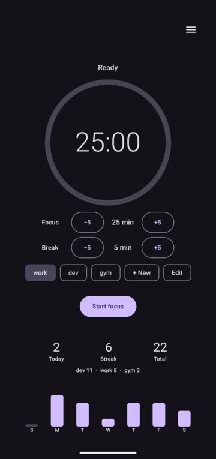
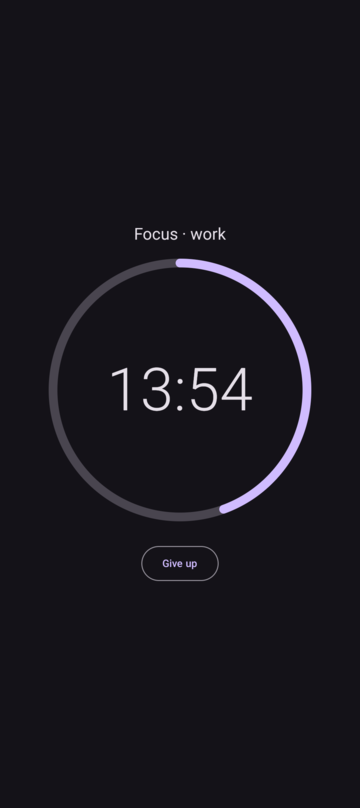
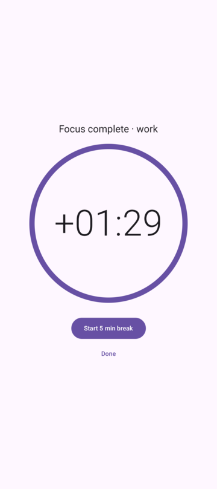
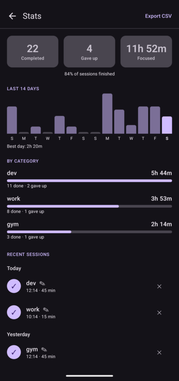
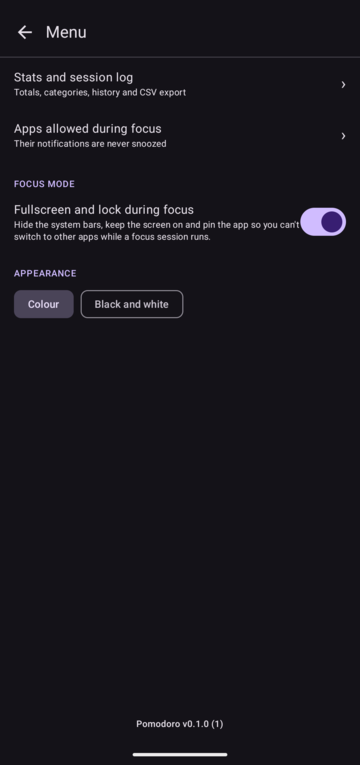
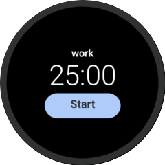
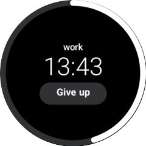
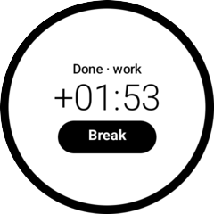

# Pomodoro

Minimal Android pomodoro timer that silences notifications while you focus.

- 25 min focus, 5 min break, started and stopped with one button.
- During focus, notifications from every app are snoozed and reappear when the session ends.
- Apps you allow ("Apps allowed during focus") are never touched. Calls, alarms,
  navigation and ongoing notifications always pass through.
- Records: completed sessions are stored locally (SQLite). Home shows today, streak,
  total and the last 7 days. Giving up early does not count.

## Screenshots

Phone (sample data):

| Home | Focus | Focus complete | Stats | Menu |
|:---:|:---:|:---:|:---:|:---:|
|  |  |  |  |  |

When a focus session ends the screen inverts and the timer keeps counting up (`+mm:ss`) until you tap.

Watch (Wear OS):

| Ready | Focus | Focus complete |
|:---:|:---:|:---:|
|  |  |  |

## Install (no store)

1. Push to GitHub. The `debug` workflow produces a `pomodoro-debug` artifact containing `pomodoro-<version>-debug.apk`. For a signed release, push a `v<version>` tag: the `release` workflow publishes `pomodoro-<version>-release.apk` as a GitHub Release.
2. Download `pomodoro-<version>-release.apk`, copy it to the phone, and install (allow "install unknown apps").
3. Open the app and tap **Grant access** to enable notification access.
   On Android 13+, sideloaded apps may first need
   Settings > Apps > Pomodoro > ⋮ > **Allow restricted settings**.

## Watch (Wear OS)

`pomodoro-wear-<version>-release.apk` is the Wear OS companion. The phone owns the timer, blocks the
notifications and logs the sessions; the watch shows the progress ring and can start or stop a session.
It needs the phone app, and Google Play services on both devices.

Install it over wireless debugging (no store needed). On the watch, enable Developer options
(Settings > System > About > tap Build number 7 times), then Wireless debugging, and:

```bash
adb pair <ip>:<pairing-port>       # enter the code shown on the watch
adb connect <ip>:<port>
adb -s <ip>:<port> install -r pomodoro-wear-<version>-release.apk
make wear-install WATCH=<ip>:<port>   # from a checkout: builds and installs the debug build
```

Install the phone and watch apps from the same release: they must be signed with the same key.

Local build needs JDK 17, the Android SDK and Gradle 8.9: `gradle assembleDebug`.

## Releasing

Releases are signed with a dedicated key that is kept outside the repository. Its location and password are
set in a git-ignored `env.mk` (see `kotlin-devkit/env.mk.example`) and, for CI, in the repo's GitHub secrets.
**Back up the keystore and its password:** without them an installed app can't be updated in place
(uninstall erases its data; export the CSV first).

```bash
make bump PART=patch      # versionName + versionCode
# commit and push, then either:
make publish              # build locally, verify, upload to a GitHub release
git tag vX.Y.Z && git push origin vX.Y.Z   # or let GitHub build and publish it
```

Both paths build the phone and the watch APK, check that each one's embedded version matches `versionName` and
that it is signed with the release key (`RELEASE_CERT_SHA256`), and attach both plus a `SHA256SUMS` file. Verify a download with `sha256sum -c SHA256SUMS`.

## Limits

- A notification can flash for a moment before it is snoozed.
- The end-of-session alarm is not exact to the second (`setAndAllowWhileIdle`).

## Dev loop

Uses [kotlin-devkit](https://github.com/comichao/kotlin-devkit): `make debug`, `make phone`, `make logcat`, `make bump PART=patch`, `make help`.
